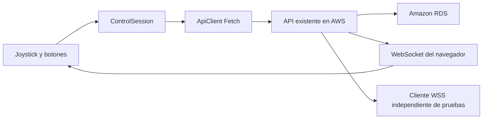

# NODE/01 — Control IoT · Práctica 4.1

Aplicación existente de control Mobile First con HTML5, CSS3, Bootstrap 5 y módulos ES6. Conserva el diseño oscuro/teal de NODE/01 y usa la API FastAPI ya desplegada en AWS. Incluye únicamente CONTROL; no añade backend, procedimientos almacenados, administración, monitoreo histórico ni conexiones RDS desde el navegador.

## Estado comprobado

El 9 de noviembre de 2026 se ejecutaron pruebas automáticas locales y una revisión real en navegador mediante `http://localhost:5500`. Se inspeccionaron escritorio 1440×1000, móvil emulado 390×844 y 844×390, y pantalla estrecha 320×568: sin desbordamiento horizontal. Se comprobó navegación por teclado, cierre de Acceso con Escape, retorno de foco y neutral con catálogo ausente. No se introdujeron credenciales ni se hicieron POST reales.

**Bloqueo de red:** DNS resolvió el dominio de la API, pero TCP al puerto 443 agotó el tiempo desde esta computadora. Esto no demuestra que EC2 estuviera apagado. AWS/API, certificado TLS, RDS, CORS y WSS en línea siguen sin verificación concluyente. Los intentos GET/OPTIONS y los datos medidos están en [DIAGNOSTICO_RED](./docs/DIAGNOSTICO_RED.md) y [JSON original](./docs/diagnostico-red.json).

Las capturas locales en `evidencias/` documentan el estado real observado; no sustituyen una prueba en teléfono físico ni evidencias de operación. `entregables/` conserva Word/PDF de avance. Ambas carpetas quedan fuera de Git y Pages.

El enunciado institucional está en [`docs/Enunciado_Practica_4_1_IoT.txt`](./docs/Enunciado_Practica_4_1_IoT.txt), con un nombre distinto del inicialmente indicado. Se leyó completo y se cotejaron sus requisitos; la guía de evidencias distingue implementación, pruebas locales y validación pendiente en el despliegue real.

## Ejecutar y probar

Desde PowerShell:

```powershell
Set-Location -LiteralPath 'C:\Users\joseh\Downloads\control-iot-jack'
npm test
npm run serve
```

Abrir [http://localhost:5500](http://localhost:5500). Se requiere Node.js para los tests y Python para el servidor; no hay dependencias npm ni compilación. Evitar `file://` por los módulos ES6. Bootstrap se obtiene de CDN; CSS local incluye una distribución de contingencia si el CDN falla.

`npm test` usa `node:test`, fetch/WS ficticios y eventos DOM de prueba. La verificación final pasó **55/55 pruebas**. Cubre alias del catálogo e identificadores distintos del código, Pointer Events, botones, toque, teclado, neutral, histéresis, captura, pérdida de foco, STOP prioritario, cola de última dirección, respuestas tardías DEMO, reconexión, HTTP 202 y secretos sólo en RAM. **Estos tests no mueven el vehículo ni certifican AWS o RDS.**

## Configuración y contrato existente

- Backend separado: [Jack28-08/api-vehiculo-iot](https://github.com/Jack28-08/api-vehiculo-iot).
- API: `https://184-72-72-255.sslip.io`; [Swagger](https://184-72-72-255.sslip.io/docs).
- WSS: `wss://184-72-72-255.sslip.io/ws/vehiculos/1`.
- Vehículo: `id_vehiculo=1`. URLs y rutas en `js/config.js`, sin secretos.

| Finalidad | Método y ruta |
| --- | --- |
| Salud API | GET `/health` |
| Salud RDS | GET `/health/db` (200/503 según respuesta real) |
| Vehículo y comandos | GET `/vehiculos/1`, GET `/vehiculos/1/comandos` |
| Catálogo DEMO | GET `/vehiculos/1/demos` |
| Pasos de una DEMO recibida | GET `/vehiculos/1/demos/{id_demo}/movimientos` |
| Movimiento individual | POST `/vehiculos/1/movimientos` |
| Inicio DEMO | POST `/vehiculos/1/demos/{id_demo}/iniciar` (exige HTTP 202) |
| Cancelar DEMO | POST `/vehiculos/1/demos/{id_demo}/cancelar` |
| Detención lógica | POST `/vehiculos/1/detener` |

Los POST requieren `X-API-Key` de operador. Movimiento envía, por ejemplo, `{"id_comando":2,"origen":"CONTROL-WEB"}`. El identificador siempre se toma del objeto GET: **no se deduce de `codigo`**. Los nombres observados por el alumno para este vehículo son GI, AVANZAR, VELOCIDAD, SUBIR_GRUA, RETROCEDER, DEMO, BAJAR_GRUA y GIRAR_DERECHA. No son un catálogo de respaldo: los botones sólo se crean desde un GET válido. GI tiene presentación de izquierda; la búsqueda conserva el objeto real y su identificador. DEMO del catálogo es un comando individual distinto de una secuencia DEMO del servidor.

## Seguridad y operación

La persona autorizada introduce su clave temporal en **Acceso**. Se conserva exclusivamente en un campo privado del cliente en RAM; se limpia del input al guardar/cerrar y de memoria al borrar, recargar o abandonar la página. No se usa almacenamiento persistente, cookies ni claves fijas. Los GET no incluyen la clave. No se registra en consola ni se refleja texto arbitrario de errores HTTP del servidor. Una persona con acceso a DevTools de su propia sesión podría inspeccionar el encabezado que envía: cerrar Headers antes de cualquier captura y no guardar HAR con autenticación.

Un test antiguo contenía una cadena sensible incrustada y fue sustituido antes del primer commit de este repositorio. Si esa credencial era válida o se publicó en otro lugar, debe rotarse por el responsable; este frontend no administra claves.

Los tests de operación se ejecutan con dobles locales. Las pruebas reales de movimiento, STOP y DEMO deben realizarse con permiso explícito y operador presente. Abrir o recargar el sitio sólo consulta salud/catálogos y abre el monitor WSS; no inicia movimientos automáticamente.

## Control y condiciones de carrera

El joystick usa Pointer Events con captura, botón principal, un puntero y una fuente de entrada a la vez. Hay histéresis alrededor del centro y las diagonales para evitar cambios por vibración. Envía por cambio de dirección, sin temporizador de repetición. Durante un POST se conserva sólo la última dirección pendiente. Flechas sostenidas no repiten envíos. Soltar, cancelar, perder captura, perder foco, ocultar la página o pulsar Escape/espacio neutraliza y solicita STOP cuando existe una maniobra activa del joystick.

DETENER descarta la dirección pendiente, neutraliza el gesto y aborta el fetch del movimiento. Su POST no espera la cola local. Generaciones de operación y `id_ejecucion` evitan que respuestas tardías sobrescriban una detención o una DEMO finalizada. Un STOP sin confirmación deja las acciones bloqueadas hasta recibir una detención confirmada. STOP continúa disponible.

**Límite de STOP:** AbortController interrumpe la espera del navegador; no revierte un POST ya recibido/procesado por el servidor. La coordinación real depende del backend y puede incluir una transacción en curso. STOP es una detención lógica; ni HTTP 200/202 ni un evento WSS certifican el movimiento o la detención de motores.

## DEMO y WSS

El cliente consulta el catálogo y los pasos por GET; no contiene secuencias ni temporizadores de ejecución fijos. El inicio permanece deshabilitado hasta cargar pasos, y no compite con un movimiento en vuelo. AWS ejecuta los tiempos de RDS. Los pasos de una DEMO reportada por otro cliente también se consultan por su `id_demo` real.

Eventos admitidos del contrato: `estado_inicial`, `movimiento_individual`, `demo_inicio`, `demo_movimiento`, `demo_fin`, `demo_cancelada`, `demo_error`, `detencion_logica`. Se filtran por vehículo; los pasos DEMO se relacionan por `id_ejecucion` y `orden`. La coincidencia temporal de un movimiento individual no equivale a un identificador único de solicitud.

El monitor WSS del navegador se reconecta con espera progresiva y evita conexiones duplicadas. `estado_inicial` contiene un snapshot histórico del movimiento, **no informa si el ejecutor DEMO sigue activo**. Si se pierde WSS durante DEMO, reconectar no borra esa incertidumbre; Cancelar o DETENER permiten recuperar un estado confirmado. El monitor no ejecuta comandos al recibir eventos y no sustituye al cliente WS externo de las evidencias.

En el código del backend se revisaron las consultas de pasos RDS, HTTP 202, orden de publicación y la omisión de historial individual en movimientos DEMO. Falta verificar esos resultados en la API desplegada mediante pruebas autorizadas; ver las fuentes en el diagnóstico.

## Indicadores independientes

| Indicador | Evidencia usada | Resultado no concluyente |
| --- | --- | --- |
| WSS navegador | Eventos open/close/error y reconexión | Conectando, Desconectado o Reconectando; no acredita vehículo físico |
| AWS/API | GET `/health`, HTTP 200 y `status=ok` | `Sin verificar` por red/CORS/timeout; respuesta HTTP de error indica no disponible |
| RDS | GET `/health/db`, HTTP 200 y `status=ok`; 503 indica no disponible | `Sin verificar` por fallo de red o API sin confirmar |

Reintentar conexión sólo repite lecturas. No hay datos ficticios cuando falta conectividad. La lectura de RDS no se degrada por un simple cambio temporal de texto del indicador API ni se confirma por WSS.

## Estructura



```text
assets/favicon.svg      Identidad propia
css/styles.css          Diseño oscuro/teal y distribución responsiva
js/config.js            Rutas, vehículo y tiempos de diagnóstico
js/api.js               REST, timeout y clave sólo en memoria
js/catalog.js           Catálogo validado y alias de presentación
js/control.js           Coordinación de STOP, movimientos y DEMO
js/joystick.js          Pointer Events, teclado y neutral
js/socket.js            WSS nativo y reconexión
js/ui.js                Presentación segura con textContent
js/main.js              Coordinación de DOM, salud y GET
tests/                  Regresiones locales sin red
docs/                   Guías, CORS propuesto y diagnóstico medido
```

## GitHub Pages

El repositorio local está separado del backend y tiene rama `main`. La cuenta GitHub autenticada fue comprobada como `Jack28-08`. La consulta del destino devolvió 404 durante la preparación; todavía no se creó ni publicó.

Destinos **previstos, pendientes de publicación y verificación**:

- Repositorio: [https://github.com/Jack28-08/control-iot-jack](https://github.com/Jack28-08/control-iot-jack).
- Página: [https://jack28-08.github.io/control-iot-jack/](https://jack28-08.github.io/control-iot-jack/).

[DESPLIEGUE](./docs/DESPLIEGUE.md) contiene los comandos exactos de PowerShell con `gh`, validación del remoto y configuración **main → raíz**. La creación/push/publicación requieren la autorización solicitada por el alumno. Sólo se publica el frontend; no Vercel ni backend. Rutas relativas, `.nojekyll`, favicon SVG propio y footer `Desarrollado por José Héctor Rosales Cabrera · 2026` están conservados.

### CORS pendiente

El `app/main.py` revisado no declara CORSMiddleware. Sin respuesta HTTPS no se puede comprobar el CORS del despliegue (podría existir en un proxy). [CORS_PROPUESTO](./docs/CORS_PROPUESTO.md) documenta un parche mínimo limitado a `http://localhost:5500` y `https://jack28-08.github.io`, métodos GET/POST/OPTIONS y headers Content-Type/X-API-Key/Accept, sin comodines ni credenciales de cookies. Es sólo una propuesta: no se modificó ni publicó el backend. Swagger del mismo origen puede funcionar aunque el frontend no tenga CORS.

## Evidencias y entrega

Seguir [las siete evidencias](./docs/PRUEBAS.md). Faltan teléfono físico, CORS con respuesta real, certificado, GET de catálogos y todos los pasos, WSS en línea y cliente WS independiente, POST autorizados, inicio202/orden/fin/cancelación DEMO, comprobación real de ausencia de historial y publicación Pages. El PDF y Word actuales documentan únicamente lo realizado y los pendientes. El cierre requiere URLs públicas verificadas y capturas auténticas de esas pruebas.
