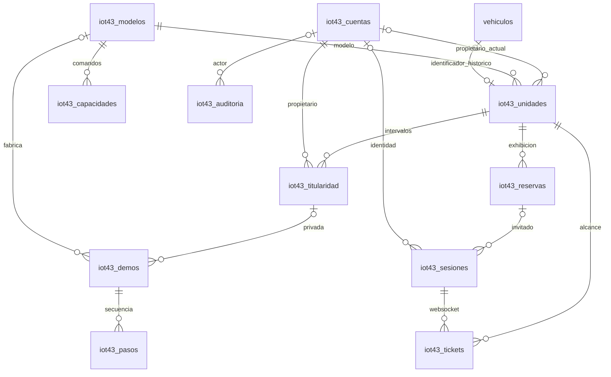

# Verificación de la migración MySQL de NODE/01

El inventario RDS propio del 16 de octubre de 2026 describe seis tablas y 21 procedimientos vistos mediante la cuenta de lectura. Para esta revisión se reprodujo su DDL local en un proceso MySQL Community Server 8.0.46 aislado, en `127.0.0.1:43343`, con un directorio de datos temporal separado del servicio MySQL80. Las filas de prueba son sintéticas. Los conteos reales de producción y su respaldo deben obtenerse antes de migrar Amazon RDS. [Repositorio del backend](https://github.com/Jack28-08/api-vehiculo-iot)

## Tablas históricas

| Tabla | PK | Índices y relaciones principales | Filas sintéticas antes y después |
| --- | --- | --- | ---: |
| `vehiculos` | `id_vehiculo` INT autoincremental | PK sin dependencia de las tablas comerciales. | 2 |
| `comandos` | `id_comando` INT autoincremental | FK de vehículo con CASCADE. Nombre y código únicos dentro de la unidad. | 3 |
| `estado_vehiculo` | `id_estado` INT autoincremental | FK de vehículo con CASCADE y unicidad por vehículo. FK de comando permite SET NULL. | 1 |
| `historial_comandos` | `id_historial` BIGINT autoincremental | FK de vehículo con CASCADE. FK de comando permite SET NULL para conservar registros. | 3 |
| `demos` | `id_demo` INT autoincremental | FK de vehículo con CASCADE. | 1 |
| `demo_movimientos` | `id_demo_movimiento` INT autoincremental | FK de DEMO con CASCADE. FK de comando con RESTRICT. Orden único por DEMO. | 2 |

Los índices físicos, columna, colación, PK, FK, restricciones y procedimientos auditados se conservan en `evidencias/preflight-antes.tsv` y `evidencias/preflight-despues.tsv` del directorio de entrega. El control de referencias cruzadas comprueba que el comando de un paso, estado o registro pertenezca al mismo vehículo. En este ejercicio las cinco comprobaciones históricas y las cuatro comerciales devolvieron cero incidentes.

## Resultados del laboratorio

- En `vehiculo_iot` se aplicó `000_preflight.sql`, el DDL aditivo `001_schema.sql` y la verificación `003_verify.sql`. Aparecieron 12 tablas comerciales y se conservaron los 21 procedimientos.
- Se compararon volcados antes y después de las seis tablas históricas. La huella del DDL y las rutinas fue `A0C34EB1E0EE6661436F384C258C98EB2574192E6C2050FA8AFA8054F7D51FFE` en ambos lados. Los registros sintéticos comparados produjeron `9DDF48EFBA6CF3DA8BD98BA5B9F9DF2BE578D91D10808AF054ACCECE8165F577` antes y después.
- `002_seed_controlado.sql` quedó bloqueada en el esquema de control aunque se habilitó la variable de ensayo. En la copia llamada `vehiculo_iot_lab` la primera ejecución habilitó el ID histórico 3 de exhibición virtual. La segunda ejecución devolvió el mismo ID.
- El respaldo entregado `Respaldo_DDL_Historico_Laboratorio.sql` incorpora los objetos históricos reproducidos y omite el DEFINER de la cuenta de laboratorio. Su huella sanitizada está en `evidencias/migracion-mysql.json`. El archivo sirve para restaurar un esquema nuevo y aislado. Los resultados corresponden a laboratorio.

## Entidades y asociaciones comerciales

`iot43_migraciones` registra versiones aplicadas. SKU, serie, usuario y la relación con el ID histórico están sujetos a unicidad. Las capacidades se identifican por modelo y código. Los pasos tienen un orden único dentro de la secuencia. La fila de unidad se bloquea al asignar o reservar. Los intervalos de titularidad retienen al comprador y fechas de vigencia. El bloqueo de cuenta y la baja lógica conservan las asociaciones que se requieren para auditoría. El esquema histórico se mantiene separado.

## Recuperación

En producción guarda snapshot y volcado lógico antes de ejecutar el DDL. El respaldo debe poder restaurarse en una instancia nueva junto con PK, FK, índices, rutinas y conteos verificados. Si la migración falla, conserva la instancia y los registros de aplicación, vuelve al código/configuración documentados y decide si restaurar en otra instancia. El retorno operativo después de permitir escrituras requiere reconciliar los datos posteriores al respaldo. Las instrucciones de la guía detallan el orden de verificación. [DDL y commits implícitos en MySQL](https://dev.mysql.com/doc/refman/8.0/en/implicit-commit.html) · [Restauración en Amazon RDS](https://docs.aws.amazon.com/AmazonRDS/latest/UserGuide/USER_RestoreFromSnapshot.html)
